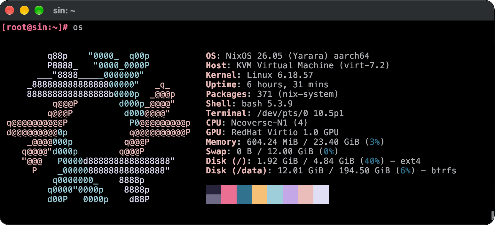

# Machine

NixOS for running containers.  
A system tuned for OCI container runtimes.



Start one from the template:

```sh
nix flake init -t github:monoflake/machine#machine
```

Then set the disk, the memory, your SSH key and the [names and labels](docs/names.md) in
`configuration.nix`.

## License

MIT License © 2026 [Canmi](https://canmi.net)
